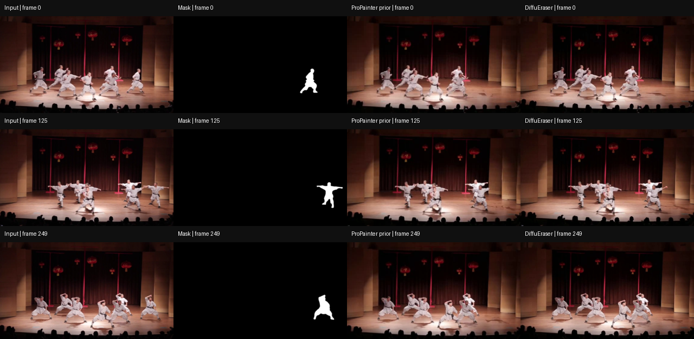

# DiffuEraser recorded inference

Pretrained inference on the authors' supplied example3. No training or quantitative benchmark evaluation.

[Input](input_video.mp4) · [Mask](input_mask.mp4) · [ProPainter prior](propainter_prior.mp4) · [DiffuEraser output](diffueraser_result.mp4) · [Command](command.sh) · [Log](run.log) · [Environment](environment.freeze.txt) · [Hashes and metadata](artifact_manifest.json)

Final output: 250 frames, 960 × 536, 25 FPS. Comparison frames: 0, 125, 249.

