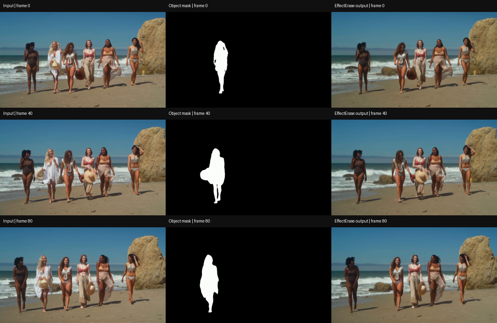

# EffectErase recorded inference

The authors' supplied video and object mask were processed with their pretrained model. This is a demonstration of inference, with no training or quantitative benchmark evaluation.

[Output video](removed.mp4) · [Comparison](comparison.png) · [Command](command.sh) · [Log](run.log) · [Environment](environment.freeze.txt) · [Hashes and video metadata](artifact_manifest.json)

Decoded output: 81 frames, 832 × 480, 30 FPS. Comparison rows show frames 0, 40 and 80.

