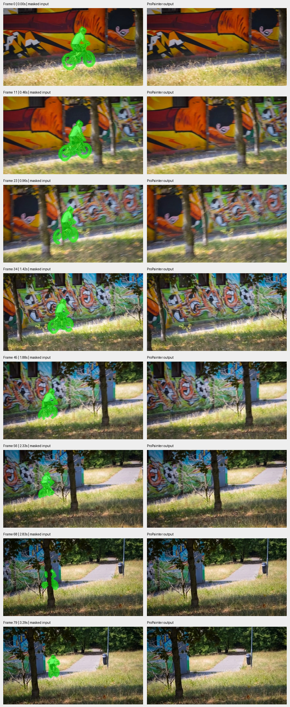

# ProPainter: BMX object removal

Pretrained inference run by Smayan Gupta on 5 October 2026.

[Output video](inpaint_out.mp4) · [Masked input](masked_in.mp4) · [Metadata and SHA-256 hashes](artifact_manifest.json)

80 frames, 432 × 240, 24 saved FPS, 3.33 seconds. Both videos were fully decoded
without errors. The comparison shows corresponding sampled frames.
The cyclist and bike are removed from the reconstructed scene.
No quantitative benchmark score was measured. A complete runtime log and exact
source commit were not retained for this original run.
