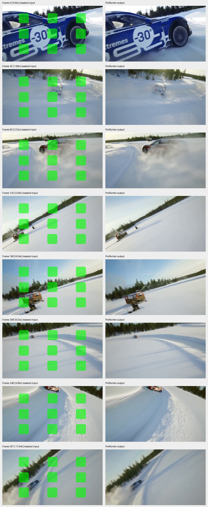

# ProPainter: video completion

Pretrained inference run by Smayan Gupta on 5 October 2026.

[Output video](inpaint_out.mp4) · [Masked input](masked_in.mp4) · [Metadata and SHA-256 hashes](artifact_manifest.json) · [Execution screenshot](run-console.png)

292 frames, 432 × 240, 25 FPS, 11.68 seconds. Both videos were fully decoded
without errors. The comparison shows corresponding sampled frames, with the
square masked regions filled by ProPainter.
No quantitative benchmark score was measured. A complete runtime log and exact
source commit were not retained for this original run.
